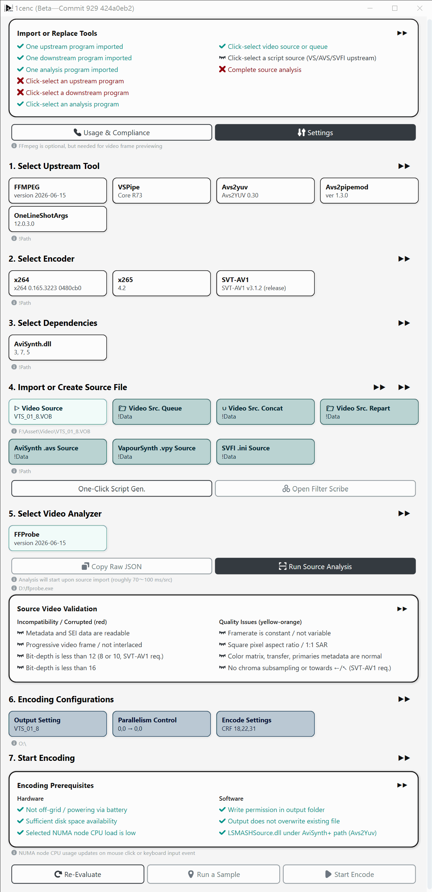

# OneColumnEncoder

OneColumnEncoder (1cenc) has the video filtering-encoding procedures presented and controlled primarily via the UI, guided by a top→down, left→right flow that minimizes what would otherwise be the numerous things to pay attention to. Allowing fast, precise, advanced, customized, validated and previewed encoding and filtering configurations, plus an easy out of box experience.

OneColumnEncoder (1cenc) 以 UI 操作主导，呈现完整的视频滤镜与编码流程，遵循从上到下、从左到右的线性操作逻辑，将原本需要同时关注的大量细节优化到极致。用户得以快速而精确地完成验证可行、且预览检查确认过的复杂自定义编码与滤镜处理配置，同时获得开箱即用的便捷体验。

## Docs

**How-to tutorial | 使用教程**

- [GitHub/iAvoe/OneColumnEncoderTutorial](https://github.com/iAvoe/OneColumnEncoderTutorial)

**Detailed project description with screenshots and usage overviews | 项目描述、截图和用法概览**

- [README-EN.md](./Docs/README-EN.md)
- [README-ZH-CN.md](./Docs/README-ZH-CN.md)
- [README-ZH-TW.md](./Docs/README-ZH-TW.md)

**Detailed explanation of the concept & design | 概念与设计详情**

- [ConceptsAndFeatures-EN.md](./Docs/ConceptsAndFeatures-EN.md)
- [ConceptsAndFeatures-ZH-CN.md](./Docs/ConceptsAndFeatures-ZH-CN.md)
- [ConceptsAndFeatures-ZH-TW.md](./Docs/ConceptsAndFeatures-ZH-TW.md)

**Other related documents (EN-only) | 其他相关文档（仅英文）**

- Designs of the buttons: [ButtonManagement.md](./Docs/ButtonManagement.md)
- The 4 encoding modes: [EncodingModeImplementation.md](./Docs/EncodingModeImplementation.md)
- Checklist editing: [EditingChecklist.md](./Docs/EditingChecklist.md)
- Routing of encoding mode: [EncodingModeImplementation.md](./Docs/EncodingModeImplementation.md)
- The encoding monitor: [EncodingModeImplementation.md](./Docs/EncodingModeImplementation.md)
- Image A/B preview design: [ImgPreviewVM-PreviewGeneration.md](./Docs/ImgPreviewVM-PreviewGeneration.md)
- IntegerSlider usage: [IntegerSliderUsage.md](./Docs/IntegerSliderUsage.md)
- ItemCard element: [ItemCardManagement.md](./Docs/ItemCardManagement.md)

## i18n

- English
- 中文简体
- 中文繁體
- Français
- Español
- 日本語
- Русский
- Deutsch
- 한국어
- Português (Brasil)